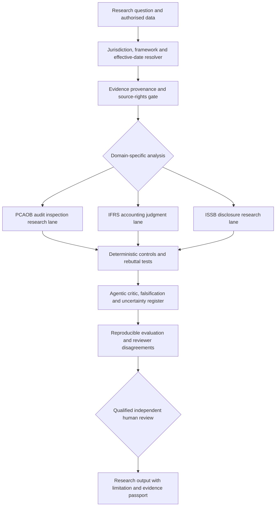

# Agentic AI for Audit Inspection, Financial Reporting and Sustainability

**Three connected research programmes** · Saeid Homayoun · University of Gävle, Sweden

[Research Highlights](RESEARCH_HIGHLIGHTS_AND_ONGOING_PROJECTS.md) · [NAAIL OpenLab](../NAAIL-OpenLab/README.md) · [Public evaluation methods](LLM_BENCHMARKS_AND_EVALUATION.md) · [Selected scholarship](SELECTED_PUBLICATIONS.md)

> **Research in progress.** The **primary working documents, developing scientific studies, and substantive research materials are maintained in my personal, access-controlled Google Drive**. This GitHub page is a curated **public research overview**, not the full internal record. Some programme implementations and supporting materials remain private; the components below vary in maturity and are **not represented as validated regulatory software**.

## Academic literature and theory validation

[**Central Harvard-style LLM / Fine-Tuning / Agentic AI reference registry**](LLM_FINE_TUNING_AGENTIC_AI_HARVARD_REFERENCES.md) — DOI-linked records spanning FT50 and AJG journal groups; bibliographic API checks; research programme relevance; and explicit distinction between theoretical motivation and independently supported empirical findings.

## FT50 journal-oriented scientific development

The **existing NAAIL two-core, three-domain, human-governed Agentic AI framework is preserved without architectural changes**. Its new [**FT50 research-design and evidence companion**](FT50_RESEARCH_DESIGN_AND_EVIDENCE.md) connects each specialist track to *The Accounting Review*, *Journal of Accounting Research*, *Journal of Accounting and Economics*, *Accounting, Organizations and Society*, *Contemporary Accounting Research*, and *Review of Accounting Studies*.

**Specialist research protocols:** [PCAOB inspections](programmes/PCAOB_FT50_RESEARCH_PROTOCOL.md) · [IFRS judgments](programmes/IFRS_FT50_RESEARCH_PROTOCOL.md) · [ISSB disclosures](programmes/ISSB_FT50_RESEARCH_PROTOCOL.md).

The added material specifies theory and rival mechanisms, unit of analysis, hypotheses, construct definitions, sources and access restrictions, identification assumptions, falsification tests, and replication gates. **These are journal-oriented designs, not acceptance promises, independently validated results, or completed empirical papers.** Primary working research materials remain in the investigator's private, access-controlled Google Drive.

## The research vision

My research examines how **human-governed, evidence-traceable agentic AI** can support three challenging professional domains without allowing a language model to substitute for a regulator, standard setter, qualified accountant, or independent assurance practitioner:

| Research programme | Central question | Research focus | Evidence state |
|---|---|---|---|
| **[PCAOB Inspection Intelligence](programmes/PCAOB_INSPECTION_AGENTIC_AI.md)** | Can inspectors and researchers use AI to systematically **identify potential gaps** between audit risks, procedures, documentation and evidence? | Audit evidence and documentation, ICFR, CAM-related risk/response research, inspection-oriented analytic tests | Research design and bounded public references; **not an official PCAOB inspection** |
| **[IFRS Judgment Intelligence](programmes/IFRS_JUDGMENT_AGENTIC_AI.md)** | Can evidence-grounded AI support **explainable accounting judgments** under applicable IFRS Accounting Standards? | Source/version resolution, IFRS 15/9/16, IAS 36/37, IFRS 18, calculations and professional decision traces | Public IFRS-AI Inspector research prototype; private-core POMELO/VERA work **not publicly validated** |
| **[ISSB Sustainability Intelligence](programmes/ISSB_SUSTAINABILITY_AGENTIC_AI.md)** | Can AI improve completeness, connectedness and verifiability of **sustainability-related financial disclosure** without treating disclosure analysis as assurance? | IFRS S1/S2, financial connectedness, climate metrics, source provenance, separate sustainability assurance research | Exploratory research design; **not an ISSB certification or completed assurance engagement** |

## A shared agentic research architecture

**Role separation:** a retrieval agent locates permitted records; a domain-analysis agent proposes testable interpretations; a calculation/control agent checks rules; a falsification agent searches for contrary evidence; a provenance agent logs source rights, dates, and claims; and a **human reviewer** decides whether conclusions are defensible. The architecture is a **research target**, not a claim that all agents are operational or autonomously reliable.

### Standards and jurisdiction must remain distinct

**PCAOB** oversight and auditing standards govern specified US audit contexts. **IASB** issues IFRS **Accounting Standards**; **ISSB** issues IFRS **Sustainability Disclosure Standards**. **IAASB** is a separate assurance standard setter and issues **ISSA 5000**, a sustainability assurance standard. A disclosure assessment under IFRS S1/S2 is *not* itself an assurance engagement, and the PCAOB is not the issuer of IFRS S1/S2 or ISSA 5000.

Applicable **jurisdiction, reporting period, adoption decisions, amendments, and effective dates** must be resolved **before** conclusions are evaluated. For example, IFRS 18 is effective for annual periods beginning on or after **1 January 2027**, with early application allowed. Reporting entities' obligations cannot be inferred from the global issue date alone.

## What can be inspected publicly

- [NAAIL Financial AI Evaluation](ai_evidence_evaluation/README.md): offline deterministic answer checks, evidence-ID logic, paired **synthetic** comparisons, declared-provenance validation and simulated reviewer agreement.
- [Research evaluation and human review rubric](ANNOTATION_AND_ADJUDICATION_PROTOCOL.md): scientific distinction between asserted citations and actual evidence entailment.
- [IFRS-AI Inspector](https://github.com/Saehon/IFRS-AI-Inspector) and its [evaluation card](https://github.com/Saehon/IFRS-AI-Inspector/blob/main/RESEARCH_EVALUATION_CARD.md): selected public financial-reporting research artefacts.
- [KIWI CAM/KAM research methods](../NAAIL-OpenLab/KIWI/README.md): structured audit risk, procedures, assurance evidence and longitudinal disclosure constructs.

**No real GPT/Claude/Gemini performance comparison, audit-firm certification, PCAOB regulatory approval, independent engagement assurance, or restricted-standard reproduction is asserted by this page.** Methods and architecture are distinguished from implemented, tested, externally reviewed, and peer-reviewed results.

## Research evaluation roadmap

1. **Scope and evidence rights:** classify public, licensed, confidential and synthetic sources; freeze jurisdiction, time, eligible tasks and explicit data-transfer permissions.
2. **Build independent domain gold:** accountants/audit experts review financial calculations, inspection risk/procedure gaps and sustainability disclosures; document disagreement, adjudication and source spans.
3. **Compare model-independent tasks:** evaluate different configurations of GPT, Claude, Gemini and/or open models only after actual, permitted runs; preserve prompts, input hashes, model versions, retrieval traces and costs.
4. **Adversarial and regulatory testing:** no fabricated citations, outdated standards, cross-framework leakage, agent self-approval, or unsupported sustainability assurance labels.
5. **Science and release gates:** report denominators, coverage, abstentions, false positive/false negative costs, robustness across periods/industries, reproducibility and qualified external critique.

## Primary professional sources

- [PCAOB — Inspection Procedures](https://pcaobus.org/oversight/inspections/inspection-procedures)
- [PCAOB — AS 1105 Audit Evidence](https://pcaobus.org/oversight/standards/auditing-standards/details/AS1105)
- [PCAOB — AS 1215 Audit Documentation](https://pcaobus.org/oversight/standards/auditing-standards/details/AS1215)
- [PCAOB — AS 2301 Auditor's Responses to Risks](https://pcaobus.org/oversight/standards/auditing-standards/details/AS2301)
- [IFRS Foundation — IFRS 18](https://www.ifrs.org/issued-standards/list-of-standards/ifrs-18-presentation-and-disclosure-in-financial-statements/)
- [IFRS Foundation — IFRS S1](https://www.ifrs.org/issued-standards/ifrs-sustainability-standards-navigator/ifrs-s1-general-requirements/)
- [IFRS Foundation — IFRS S2](https://www.ifrs.org/issued-standards/ifrs-sustainability-standards-navigator/ifrs-s2-climate-related-disclosures/)
- [IAASB — 2026 Handbook including ISSA 5000](https://www.iaasb.org/publications/2026-handbook-international-quality-management-auditing-review-sustainability-and-other-assurance)

These are hyperlinks to the official issuers; **copyright-protected standards and private inspection materials are not copied into this repository**.

*Public overview updated 31 October 2026. Status statements are bounded to publicly inspectable materials; the private research working archive may differ.*
