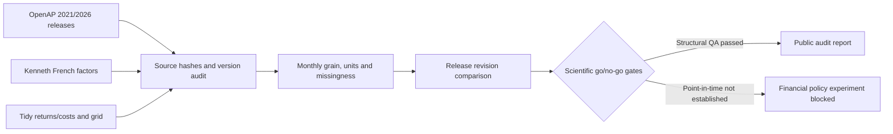

# NOMOS AI V6 | Financial Data Provenance & Reproducibility

**Public research release — Phase 1 validated, 5 November 2026**  
**Research area:** empirical asset pricing, financial data quality, computational decision economics.

NOMOS AI V6 investigates a future research question: **When is additional AI computation economically worthwhile in financial decision-making?** Before developing a financial policy, Phase 1 examines whether the source data are sufficiently traceable, complete, comparable and historically available for a credible experiment.

> **Scientific status: data audit only.** No NOMOS V6 investment policy was fitted or evaluated. No prospective return, alpha, Sharpe improvement, AI inference-cost saving, causal effect or publication acceptance is claimed. In particular, the 2026 OpenAP snapshot is retrospectively assembled and **not** a verified historical *point-in-time* trading dataset.

**Researcher:** Saeid Homayoun · [Google Scholar](https://scholar.google.com/citations?user=1PKckooAAAAJ&hl=en) · [ORCID](https://orcid.org/0000-0002-2536-0446) · [University of Gävle](https://www.hig.se/)

[Executed report](reports/PHASE1_VALIDATION_REPORT.md) · [Machine-readable QA evidence](reports/v6_quality_report.json) · [Data dictionary](docs/DATA_DICTIONARY.md) · [Phase 2 gates](docs/PHASE2_GO_NO_GO.md) · [Scholarly references](docs/REFERENCES.md)

## Verified Phase 1 findings

| Check | Observed finding | Gate |
| --- | --- | --- |
| OpenAP 2026.10 + Fama–French five factors | **60 continuous months**, Jan 2021–Dec 2025 | Structural PASS |
| Eight preselected long–short signals | No missing monthly values in the derived research panel | Structural PASS |
| FF5 factors and risk-free return | No missing monthly values | Structural PASS |
| Tidy Finance return/cost series | **48 months**, Jan 2021–Dec 2024; eight matched construction IDs | ID/date match PASS |
| Monthly keys and lag construction | No duplicates or missing months; prior-month features only | Code-level PASS |
| Historical publication-time vintage | Cannot reconstruct all original as-of information from revised releases | **NOT ESTABLISHED** |
| OpenAP–Tidy trading-cost equivalence | Portfolio specifications differ | **NOT ESTABLISHED** |
| NOMOS V6 financial policy performance | No model or backtest executed | **NOT TESTED** |

**Historical revision warning.** The March 2021 and October 2026 OpenAP releases yield materially different historical long–short returns for certain signals. For **BM (book-to-market)**, the mean absolute difference is **2.641 percentage points** over **714** months with paired data. This is an audit of released datasets, not a trading result.

## Data contracts and pinned releases

- **[Open Source Asset Pricing](https://huggingface.co/datasets/OpenSourceAP/CrossSection)** — 2026.10 revision `dd1054254c4501776432caa6d7ce5ecd9586f6a9`; 2021.03 revision `2ef566a3a35fc075ceaf5f6fd01b58d39b25e1b6`.
- **[Kenneth French Data Library](https://mba.tuck.dartmouth.edu/pages/faculty/ken.french/data_library.html)** — FF5 plus RF, source-file SHA-256 recorded by the script.
- **[Tidy Finance factor library](https://huggingface.co/datasets/tidy-finance/factor-library)** — return and cost files at revision `31887641d9df6aeeeb901c985edf3fe370dc59f7`.
- **[Tidy specification grid](https://huggingface.co/datasets/tidy-finance/factor-library-grid)** — portfolio construction metadata at revision `54da7bfaef55bdfb566849be56e9f1d5826798ea`.

**Eight prespecified signals:** Accruals, AssetGrowth, BM, Mom12m, GP, Investment, EP and STreversal. Returns from OpenAP and Kenneth French are converted from percent to decimal monthly units. **Tidy cost values retain their source units.** Tidy costs must not be mechanically applied to OpenAP strategy returns because the portfolio-construction protocols have not been reconciled.

## How to reproduce

```bash
git clone https://github.com/Saehon/Saeid-Homayoun.git
cd Saeid-Homayoun/research/nomos-ai-v6
python -m venv .venv
source .venv/bin/activate
python -m pip install -r requirements.txt
python -m pytest -q tests/test_v6_data.py
python src/build_panel.py --out outputs
```

Windows: activate with `.venv\Scripts\activate` instead of `source .venv/bin/activate`.

The eight offline unit tests do not need internet access; constructing the historical research panels does. The script records SHA-256 provenance, data quality gates and exact Tidy IDs in `outputs/v6_quality_report.json`, and creates retrospective derived CSV files locally. **Do not commit downloaded raw data or derived CSV panels to GitHub.** See [data access and licensing](data/README.md).

[](https://github.com/Saehon/Saeid-Homayoun/actions/workflows/nomos-v6-public.yml)

## Architecture



## Publication and scientific boundaries

The results establish *data structure and provenance*, not finance-policy efficacy. A prospective study must first prove historical information-release timing, factor availability, matched portfolio-construction conventions, realistic trading/shorting costs, and observed model inference cost. It must then lock an independent test period and estimate uncertainty without using held-out outcomes for model tuning.

Relevant FT50 publications inform the methodological design but **do not establish NOMOS V6's theoretical novelty or empirical superiority**. See [academic references](docs/REFERENCES.md).

## Public/private separation and license

The **original code and documentation** in this directory are part of the parent repository's [ECONOVA-S research/non-commercial license](../../LICENSE), which is **source-available, not OSI open source**. External datasets and software remain subject to their original license terms. No raw data, private Drive files, proprietary NOMOS V1–V5 kernels, credentials, or institutionally licensed market datasets are included in this release. See [third-party notices](THIRD_PARTY_NOTICES.md).

**This is research software, not investment advice.** Cite the original datasets and published work, as well as the exact GitHub commit or [software citation metadata](CITATION.cff).
