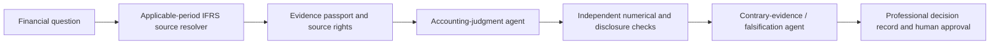

# IFRS Judgment Intelligence | Evidence-Governed Agentic AI

**Principal investigator:** Saeid Homayoun · [Research programme overview](../AGENTIC_AI_ASSURANCE_RESEARCH.md)

## Research objective

Investigate whether standards-aware retrieval, **temporal authority resolution**, deterministic reconciliation and independent agent critiques can support more transparent financial-reporting judgments—while treating materiality, estimates, policy alternatives and disclosure judgments as matters for competent human decision makers.

**Scientific questions:** Does agentic verification reduce hallucinated accounting-rule citations? Can evidence passports expose conflicting source years and inappropriate standard versions? Does requiring a separate falsification and professional approval step improve reliability and calibration?

## Accounting research portfolio

| Accounting issue | Standards or frameworks for case design | Intended test |
|---|---|---|
| Revenue recognition | IFRS 15 | Contract-term and performance-obligation evidence, revenue period and arithmetic |
| Financial instruments | IFRS 9 | Classification, credit-loss evidence, scenarios and calculation uncertainty |
| Leases | IFRS 16 | Lease terms, discounting, liability roll-forward and disclosure consistency |
| Impairment | IAS 36 | Cash-generating units, cash-flow assumptions and recoverability judgments |
| Provisions | IAS 37 | Present obligation, probability, estimation and uncertainty disclosure |
| Financial-statement presentation | IFRS 18 | New subtotals, management-defined performance measures and disclosure requirements |
| Consolidation / combinations | IFRS 10 and IFRS 3 | Control analysis, group perimeter, measurement and evidence dependencies |

The table identifies **areas of intended research**; it does not imply that all standards have been implemented, legally reproduced or fully evaluated.

**Time-aware application:** [IFRS 18](https://www.ifrs.org/issued-standards/list-of-standards/ifrs-18-presentation-and-disclosure-in-financial-statements/) applies to annual periods beginning on/after **1 January 2027** unless applied early. The framework should first establish the company's applicable accounting basis, reporting date, relevant effective amendment and jurisdiction.

## Agentic research workflow

The **Stable Knowledge / Replaceable Technology** distinction is a research design: standards governance and evidence provenance should remain traceable when an underlying LLM, retrieval technology or orchestration engine changes.

## Validation and publication gates

- Freeze authorized reference material, amendment versions and expert gold labels with human-review records.
- Evaluate numerical correctness, alternative-accounting treatments, source-text support, abstention, disagreements and case difficulty.
- Use blinded, licensed test cases and compare legitimately executed models on matched tasks; retain prompts/configuration hashes, versions, token/cost logs and controlled access.
- Classify missing standards evidence as uncertainty rather than having an agent manufacture a rule.
- Do not claim IFRS compliance, an external accounting opinion or reliable autonomous accounting decisions merely because unit tests pass.

## Research materials and development status

**Existing public artefacts:** [IFRS-AI Inspector](https://github.com/Saehon/IFRS-AI-Inspector) and its [research evaluation card](https://github.com/Saehon/IFRS-AI-Inspector/blob/main/RESEARCH_EVALUATION_CARD.md), plus [NAAIL evidence-evaluation code](../ai_evidence_evaluation/README.md).

**Private development:** POMELO™ and VERA™ are included in the ongoing research architecture. Their substantive project working documents and primary research records are maintained in **private, access-controlled personal Google Drive**. Proprietary methods and restricted standard texts are not released here.

**Boundary:** a public research architecture or synthetic demonstration is not an assertion of production readiness, professional IFRS certification, a real provider comparison or independent scientific validation. IFRS Foundation standards remain third-party copyrighted material; use official [IFRS Foundation resources](https://www.ifrs.org/issued-standards/) rather than uploading restricted passages.